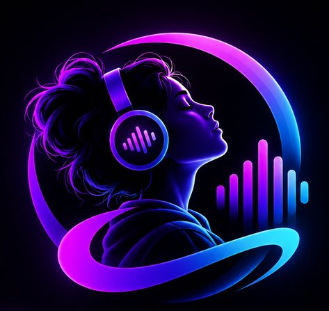

<p align="center">
  
</p>

# 🌊 SoundWave
### Next-Gen Hybrid Online & Offline Android Music Player


[](https://kotlinlang.org)
[](https://developer.android.com/jetpack/compose)
[](https://m3.material.io)
[](https://developer.android.com/media/media3)
[](https://developer.android.com/training/data-storage/room)
[](https://square.github.io/okhttp/)
[-3DDC84?style=for-the-badge&logo=android&logoColor=white)](https://android.com)
[]()

**SoundWave** has evolved from a standalone offline player into an **audiophile-grade hybrid music powerhouse**. Engineered from the ground up with **Kotlin** and modern **Jetpack Compose**, SoundWave seamlessly fuses **high-fidelity online streaming**, a **private 100% isolated offline download engine**, and a **comprehensive local offline media suite** into a unified, fluid Liquid Glass experience.

No accounts. No subscriptions. No ads. No telemetry. Just pure music.

[📥 Download Latest APK](#-download--installation) • [🚀 What's New](#-whats-new-in-the-hybrid-upgrade) • [✨ Key Features](#-key-features) • [📱 App Screens & Navigation](#-app-screens--navigation) • [🛠️ Architecture & Tech Stack](#️-architecture--tech-stack) • [👨‍💻 Developer](#-developer--author)

---

## 🚀 What's New in the Hybrid Upgrade?

SoundWave now bridges the best of both worlds:

- 🌐 **Instant 320kbps Online Streaming:** Search millions of tracks with instant on-the-fly DES-ECB hardware decryption — zero middleman servers required.
- 📥 **Private Isolated Downloads:** Download any online song in 160k/320k Studio Quality directly to SoundWave's internal sandbox (`context.filesDir/downloads/`). Completely invisible to intrusive third-party apps and media scanners.
- 🎙️ **Synchronized Real-Time Lyrics:** Millisecond-accurate auto-scrolling LRC lyrics powered by LRCLIB, complete with interactive tap-to-seek playback.
- 🕹️ **Interactive Retro Player Skins:** Switch between **Liquid Glass**, the iconic **iPod Click-Wheel** (with rotary haptic scrubbing!), **90s Cassette Tape** (with spinning reels), and **Cyberpunk Neon Turntable**.
- 🖼️ **Picture-in-Picture (PiP) Floating Player:** Keep playback controls and cover art floating over any app while multitasking or gaming.
- 📳 **Motion Gestures:** Flip your phone face down to pause instantly, or shake the phone to skip tracks effortlessly.
- 🛡️ **Diagnostic Safe Mode:** Built-in isolated crash handler process (`:crash`) with one-click clipboard copying to ensure zero mysterious app closes.

---

## 📥 Download & Installation

The ready-to-install debug APK is available directly in the project root:

| Package | Version | Target Android | Architecture | File Size | Direct File |
| :--- | :--- | :--- | :--- | :--- | :--- |
| **SoundWave APK** | `v1.0.0` (Hybrid Release) | Android 8.0 to 15 (API 26–35) | Universal (`arm64-v8a`, `armeabi-v7a`, `x86_64`) | ~24.2 MB | [`SoundWave-v1.0.0.apk`](./SoundWave-v1.0.0.apk) |

### Quick Installation:
1. Download or transfer **`SoundWave-v1.0.0.apk`** to your Android smartphone or tablet.
2. Tap the APK file in your file manager to install (grant *"Install unknown apps"* permission if prompted).
3. Open SoundWave, grant audio storage permissions, and start streaming or listening offline!

---

## ✨ Key Features

### 🌐 1. High-Fidelity Online Music Discovery & Streaming
- **Native Client-Side Decryption:** Stream full-length audio tracks directly from high-speed CDNs with client-side DES-ECB 320kbps stream decryption (`Cipher.getInstance("DES/ECB/PKCS5Padding")`).
- **Multi-Catalogue Providers:**
  - **JioSaavn Native Engine:** Millions of mainstream Bollywood, regional, and international songs with zero server dependencies.
  - **Apple Music / iTunes Catalogue:** Official trending charts, high-resolution 500x500 album art, and global genre discoveries.
  - **Internet Archive Open Audio:** Public domain recordings, live concert archives, and Creative Commons music.
- **Custom Self-Hosted API Support:** Option in Settings to route streaming through your personal `sumitkolhe/jiosaavn-api` server.
- **Selectable Stream Quality:** Toggle between **96 kbps** (data saver), **160 kbps** (balanced), and **320 kbps** (audiophile clarity).

---

### 📥 2. Private Offline Download Manager
- **100% Sandbox Privacy:** Downloaded tracks are stored in SoundWave's internal private storage directory (`context.filesDir/downloads/`). Files never pollute public media directories and cannot be indexed by third-party gallery or player apps.
- **Flexible Audio Quality:** Choose between **160 kbps** or **320 kbps Studio Quality** for offline downloads.
- **Smart Queue & Background Engine:** Multi-tasking download manager featuring real-time download speeds (kbps), byte-level progress bars, pause/resume, and retry capabilities.
- **Wi-Fi Only Toggle:** Protect mobile data quotas with automatic pause when disconnected from Wi-Fi.
- **Storage Analytics & One-Tap Clean:** Monitor disk space consumed by downloads and delete individual tracks or purge entire storage with one tap.

---

### 🎙️ 3. Synchronized Live Lyrics (LRCLIB Engine)
- **Time-Synced Auto-Scroll:** Synchronized LRC lyrics glide smoothly alongside your music in real time.
- **Tap-to-Seek:** Tap on any lyric line to jump playback directly to that timestamp.
- **Plain-Text Fallback:** Automatically fetches standard non-synced lyrics if timestamped LRC files are unavailable.
- **Zero Configuration:** Automatically cleans and matches song titles and artist names for instant lyric retrieval.

---

### 🕹️ 4. Signature Now Playing & Retro Audiophile Skins
Immerse yourself in your preferred playback aesthetic:
- **Liquid Glass (Modern Default):** Translucent frosted glassmorphic card interface with dynamic album art ambient glow.
- **iPod Click-Wheel:** Nostalgic classic iPod interface with an interactive 360° circular click-wheel, realistic rotary drag gestures for seeking, and tactile haptic vibration feedback.
- **90s Cassette Tape:** Vintage cassette player with dual synchronized rotating spools that spin during playback and halt upon pausing.
- **Cyberpunk Turntable:** Futuristic neon turntable aesthetic featuring dynamic glowing visualizer rings.
- **Interactive Vinyl Disc:** Vinyl record simulation that smoothly spins during playback. Swipe **left** on the record to skip forward, swipe **right** to play previous.
- **Fine-Grained Controls:** Variable playback speed (**0.50x to 2.00x**), sleep timer with volume ramp-down (**5 to 120 minutes**), repeat/shuffle modes, and queue reordering.

---

### 🔊 5. Studio Sound Engine & Background Service
- **AndroidX Media3 Service:** Persistent background playback powered by `SoundWavePlaybackService` (`MediaSessionService`).
- **Screen-Off & Lock-Screen Playback:** Playback continues smoothly when screen is turned off or apps are switched. Rich lock-screen notification with cover art and scrub controls.
- **5-Band Hardware Equalizer:** Fine-tune 60 Hz, 230 Hz, 910 Hz, 3.6 kHz, and 14 kHz frequency bands.
- **DSP Effects:** Bass Boost and 3D Surround Virtualizer for enhanced headphone acoustics.
- **Equalizer Presets:** Normal, Classical, Dance, Flat, Heavy Metal, Hip Hop, Jazz, Pop, Rock, and Custom.
- **Fade-In on Track Start:** Configurable volume ramp-up on track start (400ms to 3000ms) to eliminate audio clipping.
- **Smart Audio Focus:** Automatically pauses when headphones or Bluetooth disconnect, and handles incoming calls seamlessly.

---

### 📳 6. Motion Gestures & Smart Multitasking
- **Flip to Pause:** Place your phone face down on a desk or flat surface to pause music automatically using the proximity and accelerometer sensors.
- **Shake to Skip:** Shake the phone (in hand or pocket) to skip immediately to the next track.
- **Floating Picture-in-Picture (PiP):** Minimize SoundWave into a floating PiP mini-player with track artwork and playback controls while browsing or chatting.
- **Driving Mode:** High-contrast, oversized touch targets designed for safe, distraction-free control while driving.
- **4x1 Home Screen Widget:** Control playback, view album art, and skip tracks right from your launcher.

---

### 🎨 7. Cinematic Theme Engine & Custom Wallpapers
- **Dynamic Palette:** Real-time color extraction from artwork using AndroidX Palette for adaptive background lighting.
- **AMOLED Pitch-Black:** True `#000000` dark theme for maximum battery savings on OLED displays.
- **Curated Color Presets:** Graphite & Burgundy (Signature), AMOLED Crimson, Midnight Blue, Forest Green, and Purple Haze.
- **Permanent Custom Wallpapers:** Pick any image from your gallery with custom dimming (10% to 90%). Wallpapers are copied into private app storage so they **persist across reboots and cache wipes**.

---

### ✂️ 8. Local Utilities & Audio Toolkit
- **Lossless Ringtone Trimmer:** Visually select start and end timestamps from any track to create custom notification and ringtone audio files.
- **ID3 Metadata Editor:** Modify song titles, artists, and album tags directly from the app.
- **Local Listening Analytics:** Offline tracking of total listening minutes, play counts, most-played tracks, and top artists with privacy-safe Private Listening mode.
- **Excluded Folders Manager:** Exclude voice notes, WhatsApp audio, or podcasts from cluttering your music library.

---

### 🛡️ 9. Diagnostic Safe Mode (`CrashActivity`)
- Independent `:crash` Android process intercepts unexpected uncaught exceptions.
- Displays a dedicated diagnostic screen with full stack traces, one-click clipboard copying, and instant app restart to eliminate silent crashes.

---

## 📱 App Screens & Navigation

SoundWave features a modern **Liquid Glass Floating Bottom Navigation Capsule**:

```
 ┌──────────────────────────────────────────────────────────────┐
 │  [ 🏠 Home ]     [ 🧭 Explore ]     [ 📚 Library ]    ( 🔍 ) │
 └──────────────────────────────────────────────────────────────┘
```

| Screen | Description |
| :--- | :--- |
| **🏠 Home** | Personalized greeting, trending online hits, quick favorites, recently played tracks, and library statistics. |
| **🧭 Explore** | Online discovery hub with curated music genres, trending charts, top albums, and featured artists. |
| **📚 Library** | Unified tabbed local hub: **Tracks**, **Downloads**, **Albums**, **Artists**, **Folders**, and **Playlists**. |
| **🔍 Search** | Dual-mode search engine: search your **Local Library** or query millions of songs **Online** simultaneously. |
| **💽 Now Playing** | Flagship playback screen with retro skins (iPod, Cassette, Turntable, Vinyl), live LRC lyrics, gestures, and audio tweaks. |
| **📥 Downloads** | Manage downloaded audio files, sort by size/date/title, monitor storage usage, and purge downloads. |
| **🎚️ Equalizer** | 5-band gain sliders, Bass Boost, 3D Surround sound, and 10 factory presets. |
| **🚗 Driving Mode** | Large, distraction-free buttons for safe road trips and daily commutes. |
| **⚙️ Settings** | Theme engine, custom wallpapers, streaming quality (96/160/320k), Wi-Fi download locks, and developer information. |

---

## 🛠️ Architecture & Tech Stack

```
app/src/main/java/com/Soundwave/player/
├── download/               # Multi-threaded offline download manager & sandbox storage
│   └── OfflineDownloadManager.kt
├── local/                  # Room Database, DAOs, Entities, Preferences DataStore
│   ├── Daos.kt
│   ├── Entities.kt
│   ├── PreferencesManager.kt
│   └── SoundWaveDatabase.kt
├── lyrics/                 # LRCLIB synchronized LRC & plain-text lyrics repository
│   └── LyricsRepository.kt
├── mediastore/             # ContentResolver MediaStore audio scanner with exclusion filters
│   └── MediaStoreScanner.kt
├── model/                  # Immutable domain models (Song, Album, Artist, Folder, RepeatState)
│   └── Models.kt
├── online/                 # Online streaming catalogues, CDN resolvers & DES-ECB decrypter
│   ├── ArchiveSourceProvider.kt
│   ├── ArtworkRepository.kt
│   ├── ITunesSourceProvider.kt
│   ├── JioSaavnSourceProvider.kt
│   ├── MusicCatalogueRepository.kt
│   ├── MusicSearchRepository.kt
│   ├── StreamingSourceProvider.kt
│   ├── StreamResolver.kt
│   └── TrackMetadataRepository.kt
├── player/                 # MediaController client & playback queue coordinator
│   └── PlaybackManager.kt
├── repository/             # Unified facade for local & online music repositories
│   └── Repositories.kt
├── service/                # AndroidX Media3 Background Service, DSP & Motion Sensors
│   ├── AudioEffectsManager.kt
│   ├── MotionControlManager.kt
│   └── SoundWavePlaybackService.kt
├── ui/                     # Jetpack Compose UI layer
│   ├── CrashActivity.kt    # Dedicated diagnostic crash screen (:crash process)
│   ├── MainActivity.kt     # Single Activity host with PiP lifecycle support
│   ├── components/         # Liquid Glass capsule, RetroSkins, LyricsView, VinylDisc, PiP
│   │   ├── FloatingPipPlayer.kt
│   │   ├── GlassCard.kt
│   │   ├── LyricsView.kt
│   │   ├── MiniPlayer.kt
│   │   ├── RetroSkins.kt
│   │   ├── SongItem.kt
│   │   ├── SoundWaveBottomNav.kt
│   │   ├── SoundWaveTopBar.kt
│   │   └── VinylDisc.kt
│   ├── screens/            # Home, Explore, Library, Search, Downloads, NowPlaying, Settings...
│   ├── theme/              # Color, Type, Theme, DynamicPalette
│   └── viewmodel/          # MusicViewModel (Coroutines, StateFlow, MVI architecture)
├── util/                   # Ringtone trimming, crash handler, and audio file utilities
│   ├── CrashHandler.kt
│   └── RingtoneTrimmer.kt
└── widget/                 # 4x1 interactive Home Screen App Widget
    └── SoundWaveAppWidgetProvider.kt
```

### Core Libraries & Tools:

| Component | Technology | Version | Purpose |
| :--- | :--- | :--- | :--- |
| **Language** | Kotlin | `2.0.20` | Null-safe, modern reactive programming |
| **UI Framework** | Jetpack Compose | BOM `2024.10.00` | Modern declarative reactive UI |
| **Design System** | Material 3 | `1.3.0` | Liquid Glass design, dark theme, and tokens |
| **Audio Engine** | AndroidX Media3 ExoPlayer | `1.4.1` | Multi-format local and online audio engine |
| **Background Service** | AndroidX MediaSessionService | `1.4.1` | Background service & lock screen media controls |
| **Networking** | Square OkHttp | `4.12.0` | Fast HTTP requests & high-throughput streaming |
| **Local Database** | Room + KSP | `2.6.1` | Local playlists, download records, and analytics |
| **Preferences** | Jetpack DataStore Preferences | `1.1.1` | Reactive settings, themes, and configuration |
| **Image Loading** | Coil Compose | `2.7.0` | Asynchronous artwork rendering & disk cache |
| **Palette Extraction** | AndroidX Palette | `1.0.0` | Dynamic theme generation from album artwork |
| **Motion Sensors** | Android Hardware Sensors | Native | Flip to Pause & Shake to Skip motion controls |

---

## 🔨 Building From Source

### Prerequisites:
- **Android Studio** Ladybug (2024.2.1+) or newer
- **JDK 17** or **JDK 21**
- **Android SDK** Platforms `android-34` and `android-35`

### Build Instructions:

```bash
# 1. Clone the repository
git clone https://github.com/AashishCyberH4CKS/SoundWave.git
cd SoundWave

# 2. Verify Gradle build configuration
./gradlew --version

# 3. Assemble Debug APK
./gradlew assembleDebug

# Output APK will be generated at:
# app/build/outputs/apk/debug/app-debug.apk
```

---

## 👨‍💻 Developer & Author

SoundWave is designed, engineered, and maintained by:

### 👑 Aashish Babu
*Lead Developer & Software Architect*

- 💬 **Telegram:** [@NeoCypher666](https://t.me/NeoCypher666)
- 🐙 **GitHub:** [@AashishCyberH4CKS](https://github.com/AashishCyberH4CKS)

---

## 📄 License & Privacy Notice

```
SoundWave Music Player
Copyright (c) 2026 Aashish Babu.

SoundWave is engineered with zero telemetry, zero analytics tracking,
and zero accounts. Your playlists, downloads, listening habits, and custom
configurations remain 100% private and stored solely on your device.
```

Distributed under open distribution for personal and educational use.

<p align="center">
  <sub>Made with ❤️ by <b>Aashish Babu</b> for music enthusiasts worldwide.</sub>
</p>
